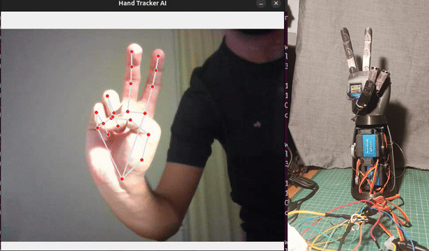
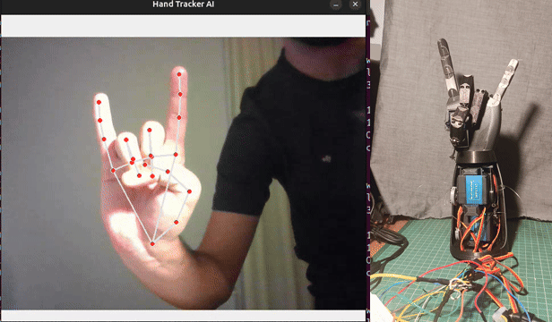
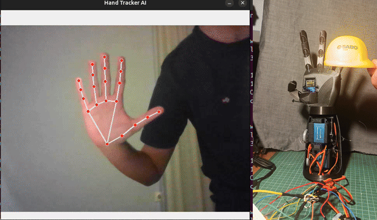

# 6-DOF Robotic Hand Teleoperation (ROS 2 + MediaPipe + micro-ROS) 


Real-time teleoperation of a **6-DOF 3D-printed robotic hand** driven by webcam hand tracking (**MediaPipe**), **ROS 2 Jazzy**, and **micro-ROS** running on an **STM32 Nucleo-F031K6** microcontroller.

> **Project Motivation:** Built as a hands-on introduction to **ROS 2** and **micro-ROS**, focusing on bridging high-level Python computer vision nodes with low-level embedded hardware over serial communication.

## 🎥 Live Demos

| Gesture Mirroring | Independent Finger Control | Object Grasp Test |
| :---: | :---: | :---: |
|  |  |  |

---

## 🏗️ System Architecture

```text
[Webcam] ──► [MediaPipe + ROS 2 Node (Python 3.12)] ──► /servo_array (Int32MultiArray)
                                                                   │
                                                       [micro-ROS Agent (USB Serial)]
                                                                   │
                                                       [STM32 Nucleo-F031K6] ──► [6x Servos]
```

* **Vision Layer (`ros2_vision/`):** Captures live webcam frames with OpenCV, extracts hand landmarks using **MediaPipe Hands**, calculates Euclidean distances from the wrist to each finger joint, and maps them to calibrated integer servo angles (`0–180°`).
* **ROS 2 Middleware:** Publishes a 6-element `std_msgs/msg/Int32MultiArray` array to the `/servo_array` topic.
* **Embedded Layer (`micro_ros_firmware/`):** A **micro-ROS** subscriber node on the **STM32 Nucleo-F031K6** receives the topic over USB serial (via `micro_ros_agent`) and drives six independent PWM servo channels in real time.

---

## ✨ Key Features & Tech Stack

* **Markerless Teleoperation:** Real-time hand tracking using a standard webcam — no flex sensors or data gloves required.
* **Decoupled Distributed Architecture:** Separates high-level computer vision on Ubuntu 24.04 (ROS 2 Jazzy) from deterministic low-level actuation on STM32 (ARM Cortex-M0).
* **Centralized Per-Finger Calibration:** Uses a `LIMITS` dictionary in Python for quick tuning of open/closed thresholds per finger, plus a `show_preview` toggle for headless, low-CPU execution.
* **Extended PWM Range:** Configures custom pulse widths (`500–2500 µs`) on the thumb base servo for full mechanical opposition.
* **Tech Stack:** ROS 2 Jazzy · micro-ROS · Python 3.12 · C++ (Arduino/STM32) · MediaPipe · OpenCV

---

## 🔌 Hardware & Wiring / Pinout

| Joint / Component | STM32 Pin | PWM Pulse Width | Topic Index | Notes |
| :--- | :--- | :--- | :--- | :--- |
| **Microcontroller** | STM32 Nucleo-F031K6 | — | — | USB Serial (`/dev/ttyACM0`) |
| **Thumb Flex Servo** | `D3` | Default | `msg.data[0]` | `0°` (open) – `180°` (closed) |
| **Index Finger Servo** | `D5` | Default | `msg.data[1]` | `0°` (open) – `180°` (closed) |
| **Middle Finger Servo** | `D6` | Default | `msg.data[2]` | `0°` (open) – `180°` (closed) |
| **Ring Finger Servo** | `D9` | Default | `msg.data[3]` | `0°` (open) – `180°` (closed) |
| **Pinky Finger Servo** | `D10` | Default | `msg.data[4]` | `0°` (open) – `180°` (closed) |
| **Thumb Base Servo** | `D11` | `500–2500 µs` | `msg.data[5]` | Extended range for opposition |

> **Power Note:** Always power the 6 servos from an external **5V–6V power supply** (min. 3A recommended) sharing a **common ground (GND)** with the STM32 Nucleo. Do not power the servos directly from the MCU's 5V pin.

---

## 🛠️ Mechanical Design & Credits

* **Base 3D Model:** The 3D-printed mechanical parts are based on an open-source robotic hand design (*[insert link to original creator/model here]](https://www.thingiverse.com/thing:2269115)*).
* **Custom Hardware Modification:** Modified the original 3D-printed parts to accommodate an **additional (5th) finger servo**, which was not supported in the stock assembly, enabling independent actuation alongside thumb opposition.

---

## 📂 Repository Structure

```text
ros2-mediapipe-robotic-hand/
├── assets/
│   ├── demo_1_rock.gif              # Gesture mirroring demo
│   ├── demo_2_fingers.gif           # Independent finger control demo
│   └── demo_3_helmet.gif            # Object grasp test demo
├── micro_ros_firmware/
│   └── robotic_hand_firmware.ino    # STM32 micro-ROS subscriber firmware
├── ros2_vision/
│   ├── hand_tracker.py              # ROS 2 MediaPipe publisher node
│   └── requirements.txt             # Python vision dependencies
├── .gitignore
└── README.md
```

---

## 🚀 Prerequisites & Installation

### System Requirements
* **OS:** Ubuntu 24.04 LTS
* **ROS 2:** Jazzy Jalisco
* **Python:** 3.12
* **micro-ROS:** `micro_ros_agent` built in `~/microros_ws`

### 1. Flash the STM32 Firmware
1. Open `micro_ros_firmware/robotic_hand_firmware.ino` in the **Arduino IDE**.
2. Ensure the `micro_ros_arduino` precompiled library and STM32 board package are installed.
3. Select **Nucleo-32 (F031K6)** and upload the sketch.

### 2. Set Up the Python Environment
```bash
git clone [https://github.com/KonstantinosKantie/ros2-mediapipe-robotic-hand.git](https://github.com/KonstantinosKantie/ros2-mediapipe-robotic-hand.git)
cd ros2-mediapipe-robotic-hand

python3 -m venv .venv
source .venv/bin/activate
pip install -r ros2_vision/requirements.txt
```

---

## ▶️ How to Run

### Terminal 1 — Start the micro-ROS Agent
Connect the STM32 Nucleo via USB and launch the serial bridge:
```bash
source /opt/ros/jazzy/setup.bash
source ~/microros_ws/install/local_setup.bash
sudo chmod 666 /dev/ttyACM0
ros2 run micro_ros_agent micro_ros_agent serial --dev /dev/ttyACM0
```

### Terminal 2 — Start the MediaPipe Vision Node
Activate the virtual environment, expose ROS 2 Python packages, and run the tracker:
```bash
source .venv/bin/activate
source /opt/ros/jazzy/setup.bash
export PYTHONPATH=$PYTHONPATH:/opt/ros/jazzy/lib/python3.12/site-packages
python3 ros2_vision/hand_tracker.py
```
Press `q` in the OpenCV preview window to exit cleanly.

---

## ⚙️ Calibration & Customization

* **Finger Limits:** Adjust the `(min_closed, max_open)` distance thresholds in the `LIMITS` dictionary at the top of `ros2_vision/hand_tracker.py` to match your camera distance and hand size.
* **Headless Mode:** To reduce CPU usage when a live camera feed is not needed, initialize the node with `HandTrackerNode(show_preview=False)`.
* **Servo Direction:** If a servo moves in reverse due to mechanical mounting, swap `180, 0` to `0, 180` in the corresponding `map_range()` call.
